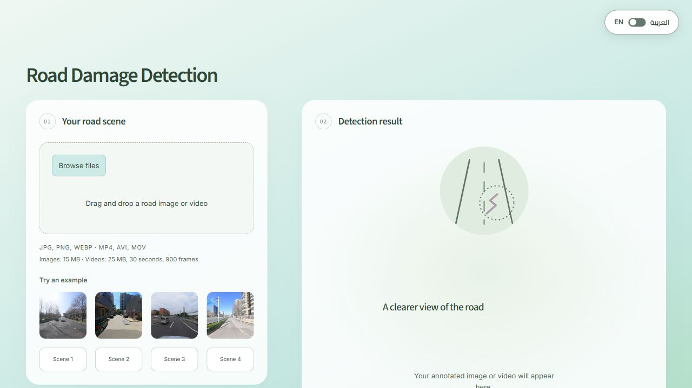
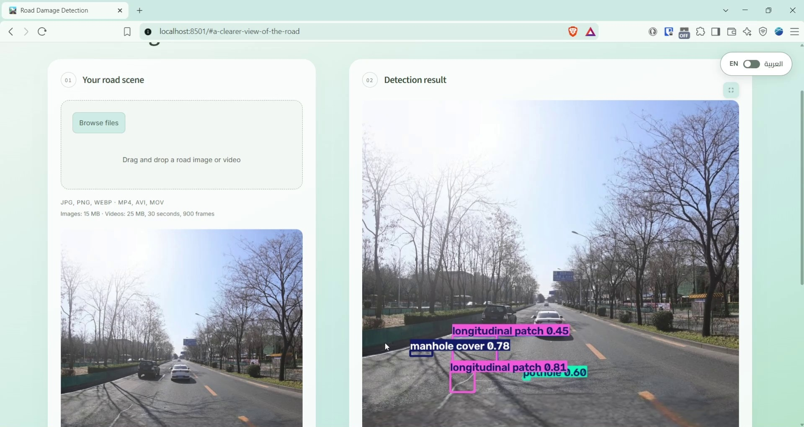

# Road Damage Detection

A computer vision project that detects and localizes seven road-scene classes,
compares three YOLO model families, tunes their training settings, and serves the
selected model through an English/Arabic Streamlit app.

**Selected model:** tuned YOLO26m · **Test mAP50:** 77.94% · **Test mAP50–95:** 49.92%

**Live app:** [Try Road Damage Detection](https://solayman-road-damage-detection.streamlit.app/)

**Status:** published on GitHub and deployed to Streamlit Community Cloud.
Local verification covers image/video processing; hosted video performance and
multi-user capacity remain unverified.



[View the Arabic layout](app/assets/streamlit-ar.png)

## Demo

[](media/road-damage-detection-demo.mp4)

[Watch or download the demo](media/road-damage-detection-demo.mp4) — a 23-second,
1920 x 1020 walkthrough showing example selection and image detection results.
The MP4 is silent and can also be uploaded directly to LinkedIn.

## What the app does

- Accepts road images and short videos, with annotated bounding boxes and English class labels.
- Provides English and Arabic controls, mirrored desktop panels, and a stacked mobile layout.
- Processes images after **Detect**; uploaded videos start automatically and show progress.
- Produces **silent H.264 MP4** video. Audio is excluded entirely.
- Preserves the selected file and result when the language changes; includes Clear and retry actions.
- Offers four example scenes covering all seven classes.
- Verifies the model checksum, class order, package version, and exported inference settings.

This is an uploaded-file demo. Processing a video may take minutes on CPU;
real-time video performance is not claimed.

## Run locally

Use **Python 3.11** and run commands from this repository's root. The supplied
requirements target CPU execution on Windows and Linux. No Kaggle session,
dataset download, or training run is needed to use the app.

### Windows

```powershell
py -3.11 -m venv .venv
.\.venv\Scripts\python.exe -m pip install --upgrade pip
.\.venv\Scripts\python.exe -m pip install -r app/requirements.txt
.\.venv\Scripts\python.exe -m streamlit run app/streamlit_app.py
```

### Linux

Install the system libraries listed in `packages.txt`, then:

```bash
python3.11 -m venv .venv
.venv/bin/python -m pip install --upgrade pip
.venv/bin/python -m pip install -r app/requirements.txt
.venv/bin/python -m streamlit run app/streamlit_app.py
```

Open the local URL printed by Streamlit, normally
[http://localhost:8501](http://localhost:8501). If a compatible environment is
already installed, run `python -m streamlit run app/streamlit_app.py` directly.

Keep these three files together:

```text
models/v3/yolo26m/
├── best.pt
├── inference_contract.json
└── labels.json
```

The selected checkpoint and its companions are allowed through `.gitignore`.
Missing or mismatched weights produce an error; the app never substitutes a
pretrained model. The expected checkpoint SHA-256 is:

```text
d4ae5f0d0af0c6654638a7da90922740e523ad4ff4d0f08149d708a661dde53a
```

## Using the app

1. Upload an image or select an example, then press **Detect**.
2. Alternatively, upload a video and wait for its annotated output to finish.
3. Use the floating **EN / العربية** switch at the top right without repeating completed processing.
4. Use **Clear** to release the current input and result.

| Input | Formats | Limits |
|---|---|---|
| Image | JPG/JPEG, PNG, WEBP | 15 MiB; 30 megapixels |
| Video | MP4, AVI, MOV | 25 MiB; 30 seconds; 900 frames; up to 3840 × 2160 |

Every decoded video frame is processed. Output uses the source's reported frame
rate; variable-frame-rate timing is normalized to that rate. Unsupported codecs,
corrupt files, and over-limit inputs are rejected. Original audio is never copied
to the output.

Uploads and results are session-local. Video frames are streamed rather than
collected in memory. Temporary input/log files are removed after processing;
output files are released on replacement, Clear, or workspace garbage collection.
There is no permanent upload history. A shared cached detector uses a prediction
lock to protect concurrent access.

## Dataset

The project uses the original **SVRDD YOLO** release:
[Zenodo record 10100129](https://zenodo.org/records/10100129),
DOI `10.5281/zenodo.10100129`. It contains 8,000 images and seven classes:

| ID | Class |
|---:|---|
| 0 | Longitudinal crack |
| 1 | Transverse crack |
| 2 | Alligator crack |
| 3 | Pothole |
| 4 | Manhole cover |
| 5 | Longitudinal patch |
| 6 | Transverse patch |

The source train/validation/test sizes were 6,000 / 1,000 / 1,000. Image decoding,
label geometry, class support, archive integrity, and cross-split similarity were
checked. A conservative perceptual-hash screen excluded 109 lower-priority images,
leaving **5,918 train / 973 validation / 1,000 test**. Similarity candidates are not
human-confirmed duplicate pairs; the screen does not establish independence by
road, location, or capture session.

Raw data is excluded from Git. Four small test-scene examples are included with
source identities and attribution in [examples/sources.json](app/examples/sources.json).
The separate Italian dataset reviewed during research was not merged into this benchmark.

## Training and hyperparameter tuning

The saved [experiment notebook](notebooks/instant-sprint02-project02-road-damage-detection.ipynb)
records data preparation, training recovery, validation analysis, tuning, final
comparison, and export.

An initial 20-epoch comparison of YOLOv8n, YOLO11n, and YOLO26n at 640 pixels
motivated a second round with larger models and higher resolution. The second
round trained **YOLOv8s, YOLO11s, and YOLO26m for 30 epochs at 1024 pixels**, using
AdamW, global batch 8, seed 2026, and the screened split. Multiple recipe changes
separate the rounds, so their gains cannot be attributed to resolution or model
family alone. The optional controlled nano-resolution experiments were not run.

The third round used **Optuna**, with three trials per model and three additional
epochs per trial. Every trial in a family started from that family's same v2
road-trained checkpoint. Trial 0 was an equal-budget reference; the other two
were search trials. Trials did not continue from one another.

| Setting | Fine-tuning search |
|---|---|
| Learning rate `lr0` | Logarithmic range `1e-5`–`3e-4` |
| Class-weight power `cls_pw` | Allowed values `0.0` and `0.5` |
| Reference | `lr0=1e-4`, `cls_pw=0.0` |
| Fixed settings | AdamW; weight decay 0.0005; 1024 pixels; batch 8; seed 2026 |
| Short-run schedule | No mosaic or warmup; final learning-rate factor 0.1 |
| Hardware | Two Tesla T4 GPUs training one trial together |
| Objective | Maximize validation mAP50–95 |

**All nine executed trials sampled `cls_pw=0.0`.** Class weighting was available
in the search space, but no weighted trial was executed. These results therefore
demonstrate learning-rate exploration; they do not measure the effect of class weighting.

| Family | Original validation mAP50–95 | Reference after 3 extra epochs | Best after search |
|---|---:|---:|---:|
| YOLOv8s | 45.833% | 45.880% | 46.281% |
| YOLO11s | 45.856% | 45.851% | 45.907% |
| YOLO26m | 49.772% | 49.709% | **49.888%** |

YOLO26m trial 002 was selected on validation, with learning rate
`0.000030863737691928355` and class-weight power `0.0`. Its deployment confidence
of **0.35** was selected separately by validation micro-F1. Test scores did not
choose the model or its confidence threshold.

The recorded Kaggle runtime used Python 3.13.15, PyTorch 2.11.0+cu128,
TorchVision 0.26.0+cu128, Ultralytics 8.4.191, and Optuna 5.0.0. The app uses a
separate CPU dependency set; installing the app requirements does not reproduce
the training environment.

### Replaying or extending the experiments

The notebook contains artifact-specific Kaggle input paths and checksum-based
recovery. It reuses the recorded v2 checkpoints with `REUSE_TRAINED_MODELS=True`
and refuses missing/mismatched inputs instead of silently repeating training.
The model folder named `yolov8n` in that uploaded v2 dataset actually contains YOLOv8s.

Completed tuning trials are tracked in SQLite and their per-trial output folders.
For cross-session continuation, preserve and attach the **full Kaggle tuning output**,
then set `HPO_RESTORE_FROM` to that attached tuning folder. The compact selected-model
ZIP does not contain all trial weights or resumable optimizer checkpoints.

Independent experiments require adapting the input identities and output roots;
the recorded notebook is not a generic one-click trainer for arbitrary checkpoints.
Use training data for fitting, validation for development, and freeze decisions
before the final test comparison. The app can be used without replaying the notebook.

## Final test comparison

Each family winner has 30 base epochs plus 3 fine-tuning epochs. All use the same
1,000-image test regression benchmark and 1024-pixel evaluation protocol.

| Model | mAP50 | mAP50–95 | Precision* | Recall* | F1* | Matched IoU* |
|---|---:|---:|---:|---:|---:|---:|
| YOLOv8s tuned | 73.68% | 45.50% | 66.44% | 72.67% | 69.42% | 0.8169 |
| YOLO11s tuned | 72.65% | 45.19% | 68.17% | 71.11% | 69.61% | 0.8144 |
| **YOLO26m tuned** | **77.94%** | **49.92%** | **70.80%** | **75.04%** | **72.86%** | **0.8264** |

*Precision, recall, F1, and matched-box IoU use confidence **0.25** and class-aware,
confidence-ordered one-to-one matching at IoU **0.50**. Matched IoU is the mean
among matched boxes, so it must be read alongside recall. These are not the
validator's precision/recall values at its maximum-F1 confidence.

mAP comes from the Ultralytics validator with confidence floor 0.001, NMS IoU 0.7,
maximum 300 detections, FP32, batch one, `rect=False`, and `nms=True`. Per-class
metrics are recorded in the experiment outputs.

| Model | Mean latency | FPS | Checkpoint size | Peak allocated GPU memory |
|---|---:|---:|---:|---:|
| YOLOv8s tuned | 28.68 ms | 34.86 | 21.55 MiB | 210.33 MiB |
| YOLO11s tuned | 28.61 ms | 34.95 | 18.37 MiB | 213.34 MiB |
| YOLO26m tuned | 64.01 ms | 15.62 | 42.07 MiB | 400.71 MiB |

Timing uses one Kaggle T4, 20 warmups, and 100 shared test images at confidence
0.25. It includes warm-cache decode, preprocessing, prediction, NMS, and returning
boxes to CPU; it excludes model loading, drawing, network, and UI time. GPU memory
is PyTorch peak allocated memory, not the whole device's usage.

**Why YOLO26m?** It delivered the highest validation AP and final test AP, with
roughly twice the checkpoint size and lower throughput than the small models.
YOLO11s is the smallest of these candidates. The mixed small/medium comparison
supports a deployment trade-off, not an equal-compute architecture ranking.

At the selected app confidence **0.35**, YOLO26m test precision / recall / F1 are
**78.65% / 69.91% / 74.02%**. Measured GPU throughput at that operating point is
15.59 FPS. These values have a different operating confidence from the common
comparison above. They do not establish CPU-host or real-time app performance.

## Inference configuration and verification

The [exported inference contract](models/v3/yolo26m/inference_contract.json)
controls image size 1024, confidence 0.35, FP32, `rect=False`, `nms=True`, IoU 0.7,
maximum 300 detections, and class order. Ultralytics is pinned to **8.4.191**.
The model is cached once, and runtime package installation and fallback downloads
are disabled.

Optional deployment environment variables:

| Variable | Purpose |
|---|---|
| `ROAD_MODEL_PATH` | Override the checkpoint location; keep its matching contract beside it |
| `ROAD_DEVICE` | Set `cpu` to force CPU; otherwise CUDA is used when available |
| `ROAD_CPU_THREADS` | CPU thread count; defaults to 2 and is bounded to 1–4 |

Run the application checks from the project root using the installed environment:

```bash
python scripts/check_streamlit_app.py
```

Checks exercise the real checkpoint on CPU, image detection, all-frame H.264
video with audio removed, corrupt/over-limit inputs, temporary-file cleanup,
example selection, language/result persistence, retry, and Clear. Additional
browser checks covered native upload/playback, Arabic panel mirroring, and mobile layout.

[CPU_SMOKE.json](app/CPU_SMOKE.json) records a limited local measurement: three
repeats of one example after warmup, two CPU threads, approximately 0.68–0.69 seconds
per annotated image and 1046 MiB process RSS. It excludes upload, UI, and model load
and is not a hosting or concurrency benchmark.

The v3 ZIP passed its CRC check and all 78 recorded member hashes matched. Complete
final reports and trial evidence are retained locally under `models/v3/experiment/`,
which is excluded from Git. The notebook's saved final-cell output is incomplete;
the verified export reports are the source of the final numbers summarized here.
Only the selected YOLO26m inference weights are included in the public app assets;
other tuned weights and resumable states remain in the full Kaggle output.

## Repository layout

```text
.streamlit/config.toml       Theme and upload configuration
app/
  streamlit_app.py           Streamlit entrypoint
  inference.py              Contract-verified model loading and prediction
  media.py                  Image validation and bounded silent-video pipeline
  translations.py           English and Arabic labels
  style.css                 Responsive styling and RTL presentation
  requirements.txt          Pinned CPU app dependencies
  examples/                 Four attributed SVRDD test scenes
  assets/                   README screenshots
media/                      Public demo MP4 and clickable preview image
models/v3/yolo26m/           Selected checkpoint, inference contract, labels
notebooks/                  Saved experiment notebook
cloud/                      Kaggle preparation/recovery/tuning/export helpers
scripts/                    Artifact audits and verification scripts
packages.txt                Linux system dependencies for hosting
README.md                   Public setup, experiment and results documentation
LICENSE                     Project-source license
```

Only this root README is included as Markdown documentation. Other Markdown notes,
the entire `research/`, `data/`, `config/`, and `docs/` folders, notebook archives,
debug/starter notebooks, scratch/output folders, training checkpoints, and experiment
databases are kept locally and ignored. Only the completed notebook shown above
and the selected model's three inference files are allowed through their respective
notebook/model ignore rules. Historical audit/download helpers may require those
local research inputs; they are not needed to run the app.

## Publish on Streamlit Community Cloud

The [public app](https://solayman-road-damage-detection.streamlit.app/) is deployed.
Image previews are sent as inline data URIs to avoid failures in the host's
generated media-file URLs. To recreate the deployment:

1. Create the GitHub repository and push the reviewed app, selected model files,
   notebook, examples, configuration, and this README.
2. In Community Cloud, select the repository/branch and entrypoint
   **`app/streamlit_app.py`**; select **Python 3.11** in deployment settings.
3. Keep `app/requirements.txt`, root `packages.txt`, and root `.streamlit/config.toml`
   included. Launch from the repository root; Community Cloud does this automatically.
4. Check model loading, EN/AR controls, one image, one short video, memory, and
   processing time on the actual host before sharing the URL. Add the working URL
   to this README after deployment.

See Streamlit's official [deployment instructions](https://docs.streamlit.io/deploy/streamlit-community-cloud/deploy-your-app/deploy)
and [dependency guidance](https://docs.streamlit.io/deploy/streamlit-community-cloud/deploy-your-app/app-dependencies).
CPU resource use and multi-user performance on the free host remain unverified.

## Limitations

- This is a small, single-seed fine-tuning search. Gains are modest; repeatability
  and statistical uncertainty have not been measured. A weighting effect was not tested.
- The test set had already been inspected in earlier rounds and is a regression
  benchmark, not a fresh independent holdout.
- Perceptual-hash screening does not prove independence by road or capture session.
  Unseen-city/camera/weather performance and a clean-road false-alarm rate remain unmeasured.
- Models differ in size and training recipe; the comparison does not establish
  architectural superiority at equal compute.
- Local CPU and Kaggle GPU timings do not predict public-host performance. The app
  provides visual assistance; results require human review.

## Attribution and license

Built by **Solayman Sameh Solayman Abdel Fattah** for the INSTANT AI & Data Analysis
Training road-damage project.

- **Dataset:** [SVRDD YOLO](https://zenodo.org/records/10100129), CC BY 4.0, with
  separate Baidu Street View imagery conditions described by the source. Keep its
  attribution and imagery conditions with any redistribution.
- **Models and training:** [Ultralytics YOLO](https://docs.ultralytics.com/).
- **Tuning:** [Optuna](https://optuna.readthedocs.io/).
- **Application:** [Streamlit](https://docs.streamlit.io/).

Original project code is provided under the [MIT License](LICENSE). Third-party
libraries, datasets, example imagery, and model weights retain their applicable
licenses; the project-source license does not replace them.
